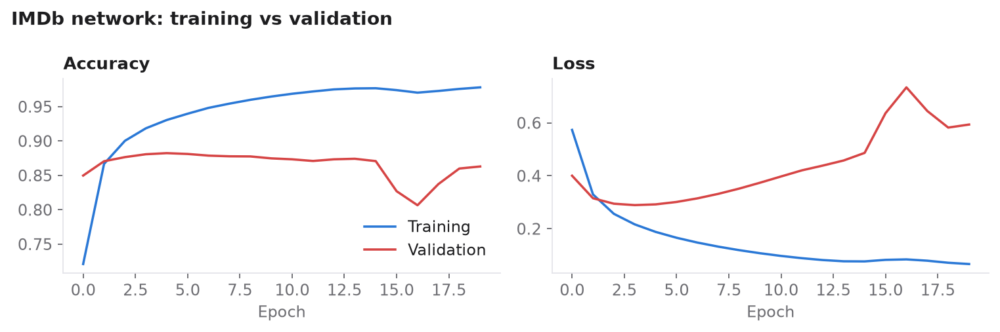
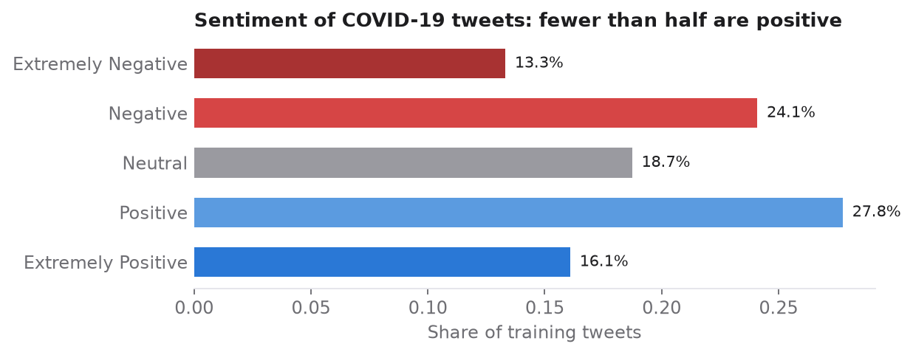
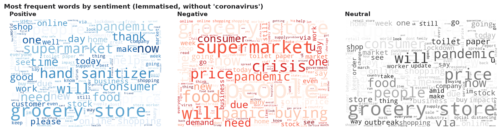
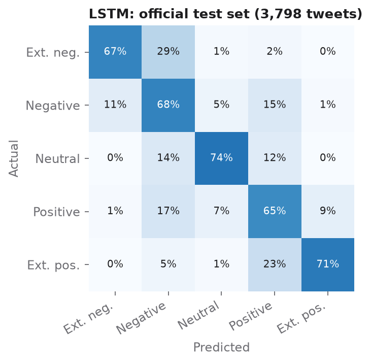
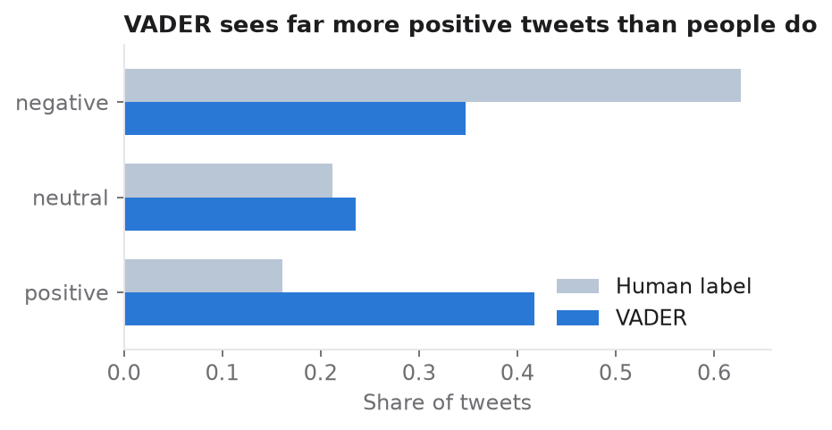

# Sentiment Analysis Three Ways: Neural Networks and a Sentiment Lexicon

   

**Case study:** [rolandkeszi.github.io/projects/sentiment-neural-networks.html](https://rolandkeszi.github.io/projects/sentiment-neural-networks.html)

Three independent studies of human-written text. Each one tests a different NLP tool on a different kind of sentiment data:

| Part | Data | Method | Result |
|---|---|---|---|
| I | IMDb movie reviews (50,000) | Word embeddings + a small neural network, two classes | **84.9 %** test accuracy |
| II | COVID-19 tweets (41,157 + 3,798) | Cleaning and lemmatisation, then a dense network vs an LSTM, five classes | LSTM **68.5 %** (5 classes), **82.1 %** (3 classes) |
| III | US airline tweets (14,640) | VADER sentiment lexicon, no training | **54.3 %** agreement with human labels |

Everything is in one executed notebook: [`notebooks/sentiment_studies.ipynb`](notebooks/sentiment_studies.ipynb).

## I. IMDb reviews: a neural network with word embeddings

The reviews come tokenised with Keras and are limited to the 10,000 most frequent words. I padded each one to 256 tokens. An embedding layer learns a 16-dimensional vector for each word. Global average pooling, a dense ReLU layer and a sigmoid output follow, for 160,289 parameters in total.

<p align="center"></p>

The model labels **84.9 %** of the 25,000 unseen test reviews correctly, and the two classes are equally balanced. After about three epochs, training accuracy keeps rising while validation loss starts to climb, which is a clear sign of overfitting.

## II. COVID-19 tweets: dense network vs LSTM

The tweets are labelled in five classes, from *extremely negative* to *extremely positive*. Fewer than half are positive.

<p align="center"></p>

Cleaning removes URLs, handles, hashtags, punctuation, numbers and stop words, then lemmatises with WordNet. The positive tweets are about *help*, *thanks* and *hand sanitizer*. The negative ones are about *panic buying*, *crisis* and *prices*.

<p align="center"></p>

Both networks start from the same 128-dimensional embedding. They are trained on 70 % of the labelled tweets, validated on 30 % with early stopping, and tested on the separate official test set.

| Model | Parameters | Test accuracy, 5 classes | Test accuracy, 3 classes |
|---|---:|---:|---:|
| Dense network (pooling + 16 + 8) | 1,282,245 | 65.1 % | 79.3 % |
| **LSTM (512) + 256 + 128 + 32** | 2,761,285 | **68.5 %** | **82.1 %** |

<p align="center"></p>

The LSTM reads the words in order, which helps with negation and intensity. Most of its errors fall between neighbouring classes, for example *positive* vs *extremely positive*. Location data are thin: India has 268 tweets, but Hungary has only 3, so the dataset cannot say anything about Hungarian sentiment.

## III. US airline tweets: the VADER lexicon

VADER scores words from −4 to +4 and adjusts for negation, intensifiers, capitals and emoticons. It needs no training. It agrees with the human labels on **54.3 %** of the tweets. When it says *negative*, it is right 90 % of the time, but it finds only half of the negative tweets. Polite words such as *thanks* push many complaints into the positive class.

<p align="center"></p>

The same data drive the interactive [airline sentiment dashboard](https://github.com/rolandkeszi/USAir).

## Conclusions

- **A small neural network is enough for a clear binary task.** 85 % accuracy needs only 160k parameters and no pre-trained embeddings.
- **Word order matters when there are more classes.** On five sentiment levels, the LSTM beats the order-blind dense network by about 3.5 points on unseen data.
- **Lexicons are fast but miss domain language.** VADER needs no data, but misreads polite or sarcastic complaints. A trained model, or an LLM (see the [LLM sentiment benchmark](https://github.com/rolandkeszi/llm-sentiment-benchmark)), does much better.

## Corrections to the original working notebooks

This repository rebuilds the analysis from my original Colab notebooks. The rebuild fixed several bugs:

- **IMDb:** the decoder ignored the Keras index offset of 3, so the "decoded" reviews were word salad. Padding used the token for *the* instead of the reserved padding index.
- **COVID tweets:**
  - The text cleaning ran without `regex=True`, so URLs and hashtags stayed in the text.
  - Sequence length was measured in characters (305) instead of words (42).
  - Labels were encoded twice, and the baseline network was never trained.
  - LSTM accuracy was measured on the training data. On the held-out test set, the LSTM beats the dense network, not the other way round.

## Run it

```bash
pip install -r requirements.txt
python -m spacy download en_core_web_sm
jupyter notebook notebooks/sentiment_studies.ipynb
```

Part II needs the Kaggle files in `data/` (see [`data/README.md`](data/README.md)). Parts I and III download their data at run time. On a CPU the whole notebook runs in about 15–30 minutes.

## Privacy

User name columns are dropped at load time. Every `@handle` is replaced with `@user` before any analysis, and no tweet data are stored in this repository.

## References

- Maas, A. L., et al. (2011). Learning word vectors for sentiment analysis. *ACL*.
- Hutto, C. J., & Gilbert, E. (2014). VADER: a parsimonious rule-based model for sentiment analysis of social media text. *ICWSM*.
- Hochreiter, S., & Schmidhuber, J. (1997). Long short-term memory. *Neural Computation*.

## License

© 2026 Roland Keszi. This work is licensed under [CC BY-NC 4.0](https://creativecommons.org/licenses/by-nc/4.0/): you may share and adapt it for non-commercial purposes, provided you credit the author (Roland Keszi) and link to this repository. Third-party datasets keep their own licenses. See [`LICENSE`](LICENSE).
